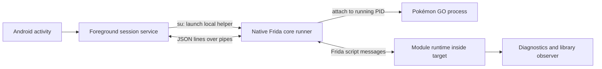

# PGQL 0.1 — Pokemon Go QoL

An original rooted Android arm64 injection app and module framework. This uses the official Frida core devkit and Java bridge; it does not depend on Pokemod's binaries, agents, backend, or credentials.

## Repository layout

- `app/` contains the Android controller; `agent/` contains the original Frida runtime, adapters and modules.
- `native/` contains the attach-only runner; `scripts/`, `patches/` and `tests/` support builds and local validation.
- `docs/` contains feature guides and [validation history](docs/VALIDATION.md). [THIRD_PARTY.md](THIRD_PARTY.md) documents third-party build inputs.
- `analysis/` contains read-only historical reverse-engineering evidence. Its recovered code is never imported, linked or packaged into PGQL.
- `build/`, `toolchains/`, `vendor/` and `node_modules/` are ignored local artifacts and dependencies. Preserve `build/debug.keystore` for installation updates.

The active project previously lived under `framework/`. Historical reports retain
those paths: `framework/...` now maps to `...` at the repository root, and the
former feature guides and validation history now live in `docs/`. File paths in
the guides are relative to the repository root unless stated otherwise.

## What runs where



The phone runs the whole session. No desktop controller or frida-server is required. The app resolves the already-running `com.nianticlabs.pokemongo` PID through root, launches the packaged native helper through `su`, and loads your bundled agent. Standard Frida injects its own agent into the target; the runner then manages script/session lifecycle.

The runner applies an attach-time **names-v1** hiding profile: injected library and worker-thread names are masked in a checksum-verified build copy of the official devkit. This covers both the main game and GO Plus processes. It reduces name-based fingerprints; instrumentation and exported entry points remain detectable. See [Frida hiding](docs/FRIDA-HIDING.md) for the PokeMod reference findings, scope and validation.

The app uses **resident-agent detach**: it requests module shutdown, waits for an acknowledgement, pins the now-inactive script, then detaches the controller. Tracked module resources are released and the menu is removed from the Activity, but Frida's engine, Java bridge internals and the inactive script remain in the game until that process exits. This avoids an observed native crash after full agent unloading on the connected phone. The native CLI supports both modes; `--resident-agent` selects this behavior. A missing shutdown acknowledgement is logged as an error and must not be treated as proof that resources were released. Reattaching loads a new script; repeatedly attaching can accumulate inactive script instances until the game process restarts. v0.1 has no resident-script reuse/hot-reload yet.

This version is attach-only (no spawn). **Start** restarts the game and attaches while it is still loading; modules wait for the game themselves.

## Build on this Mac

Existing prerequisites: Python 3, a full JDK 21, Node.js/npm, and a POSIX shell. Build inputs stay under this project, not system installations.

```sh
# Run from the repository root.
python3 scripts/bootstrap.py
npm ci
python3 scripts/build.py
```

The Java bundle pins `frida-java-bridge` 7.0.13 and esbuild 0.28.2 through `package-lock.json`. On Android 17, a checked-in compatibility patch from [upstream PR #400](https://github.com/frida/frida-java-bridge/pull/400) temporarily skips the JVMTI plugin’s heavy debug transition during plugin initialization, then restores the function and removes its temporary hooks. This is an unmerged upstream patch; it was tested on this phone, not across Android devices. The patch is applied to a build copy, leaving npm inputs intact. The bundle also defers the Java bridge’s eager constructor probe to its existing lazy initializer, and evaluates the pinned IL2CPP bridge only when a game module needs it. This keeps managed runtime probing out of script load.

Bootstrap pins Frida core **17.23.3**, Android NDK **27.2.12479018 (r27c)**, platform **35**, and build tools **35.0.0** from official release repositories. It verifies official checksum metadata and records SHA-256 values in `toolchains/dependencies.json`. Android tool downloads are macOS-specific. Set `JAVA_HOME` if your JDK lives elsewhere; the default points to this Mac's existing Homebrew JDK 21. Set `ANDROID_NDK_HOME` to use another existing compatible NDK. See the licenses shipped with the downloaded SDK/NDK inputs.

`build/pgql-debug.apk` is locally signed with the generated debug key in `build/debug.keystore`. Keep that key if you want future builds to update this installation. This is a development artifact. The project also contains Android Gradle configuration for Android Studio; prepare the agent/native runner with the scripts first. Gradle is an alternative workflow, not required by the tested manual build.

## Run on the phone

```sh
adb devices -l
adb install -r build/pgql-debug.apk
adb shell am start -n dev.qol.framework/.MainActivity
```

In PGQL, select **Start** and approve the phone's root-manager request for PGQL. Start force-stops Pokémon GO, launches it, and attaches as soon as `libil2cpp.so` is loaded (during the loading screen); the status line shows each step. If the attach crashes the game, PGQL relaunches it and tries again, up to three attempts, and copies the crash lines into the session log. Saved modules are switched back on once the map has loaded, one at a time. Module commands foreground the game so the script can process them. Look for the `agent-ready` message and diagnostics showing the target PID/architecture. **Run diagnostics** asks the enabled module for a fresh snapshot. Enable **Library load observer** to observe subsequently loaded/unloaded native libraries. Disable it to detach its observer. **Detach** closes the input pipe and ends the instrumentation session; the notification provides the same action.

An attach failure appears in the log with its native stage and error. Native Frida compatibility with this phone/game build must be tested on the connected device. Root alone does not establish that a particular game version accepts attachment.

**Explicit policy option:** the unchecked **Apply Frida SELinux setup** box forwards `--prepare-selinux` to the runner. This invokes Frida's upstream `frida_selinux_patch_policy()` and changes the live system policy until reboot. Its rules permit instrumentation memory/files and communications across application domains; it is broader than this single target. The upstream helper may briefly change enforcement if a policy-load fallback is needed. Detaching does not revert those policy changes. Review the [pinned implementation](https://github.com/frida/frida-core/blob/17.23.3/lib/selinux/patch.c) before opting in. With the box off, the framework does not write SELinux policy. The connected phone produced an observed denial reading/writing `/memfd:frida-agent-64.so` before this option was added.

## Add your own module

Create `agent/modules/your-module.js`:

```js
Qol.register({
  id: 'example',
  name: 'Example',
  settings: [{key:'verbose',label:'Verbose logging',type:'boolean',default:false}],
  enable(ctx) {
    ctx.log('Enabled', { pid: Process.id, verbose: ctx.config.verbose });
    // ctx.hook(address, callbacks) tracks an Interceptor listener.
    // ctx.observeModules(callbacks) tracks a module observer.
    // ctx.interval(callback, milliseconds) tracks a timer.
    // ctx.cleanup(fn) tracks another synchronous cleanup action.
    // ctx.notify(title, text, {latitude, longitude}) posts an Android notification
    // from the controller (title ≤ 80, text ≤ 200 characters).
  },
  invoke(ctx, args) {
    ctx.log('Action requested', args);
    return { ok: true };
  },
  disable(ctx) {
    ctx.log('Disabled');
  }
});
```

Optional `actions: [{id:"preview",label:"Preview",confirm:false}]` declarations generate buttons in the injected panel. An action calls `invoke(ctx, {action: id})`; confirmed actions call `preview` first, show counts, then wait for Continue.

`enable` and `disable` are synchronous lifecycle callbacks in v0.1; `invoke` may return a Promise. The runtime owns each module's tracked hooks/timers/observers and releases them on disable, shutdown or a failed enable. IDs are unique. The app discovers module names/status from the agent's registry. Rebuild, reinstall and detach/reattach after editing modules. Hot reload is not implemented in v0.1. A **PGQL** row in the game's own main menu, below Settings and In-Person Event Tickets, opens native-looking settings pages: `agent/adapters/game-settings-screen.js` builds them from the game's own Notifications settings prefab (section cards, toggle rows with descriptions, indented sub-toggles, buttons) and shows confirmations and results in the game's modal dialogs. Developer modules sit behind an **Advanced Settings** page; `agent/core/settings-layout.js` owns that split. If the game's UI cannot be used the original Android panel opens instead. `agent/adapters/game-main-menu.js` adds the row by cloning the game's Settings row (0.433.0 only); if that fails the floating **PGQL 0.1** button is injected instead. It displays the project name/version, module enable switches and every declared setting. Settings are `boolean` switches or bounded `text` values (`type:'text'` with `maxLength` and an optional `validate` that throws); a text setting is a button showing its value that opens an input dialog. Configuration is stored in target-private `pgql_settings` preferences and restored on attachment. Use `ctx.config` to read current settings and `onConfigChanged(ctx, config)` for immediate updates. Modules and settings may declare a `description` string, shown as the grey text under their row.

Commands are JSON objects with `type: "command"`, an `id`, and an `action` (`list`, `enable`, `disable`, `invoke`, `config`). The `config` action carries `moduleId`, `key`, and a `value` matching the setting's type (boolean, or a string for text settings). Module actions also carry `moduleId`; invoke may carry `args`. Agent responses echo the `id`, `ok`, and `result`/`error`. The helper wraps Frida messages in JSONL events on stdout. See [native/README.md](native/README.md) for standalone runner usage and limits.

## Extending into game modules

The recovered original app demonstrates a separate JavaScript managed-code bridge that resolves game services from the live Unity dependency-injection context. The core injector and that bridge are different layers. The foundation includes original diagnostics/observer modules tested inside the connected game, an injected settings panel, and an experimental Mass Gift module.

For friend gifting or other game UI modules, the next adapter should initialize against the managed runtime, resolve the needed service/type/method metadata, schedule Unity operations on the proper thread, and expose a small interface to modules. Keep compatibility maps outside individual modules. The connected phone's installed game version was confirmed as `0.431.0`, matching the recovered agent's map entry. Diagnostics confirmed the loaded Unity/IL2CPP/Niantic libraries. A first original game-gift adapter is now implemented, with a Unity-frame scheduler, version gate and Mass Gift queue. Its live validation status and limits are recorded in [MASS-GIFT.md](docs/MASS-GIFT.md); native attachment instability remains unresolved. Do not copy the recovered agent's entire bootstrap merely to obtain its module API.

Game toasts from PGQL modules show at the top of the screen, below the status
bar, rather than in the middle: `agent/adapters/game-toast.js` sets the game's
own `ToastParams.PivotY` for every module toast.

## Keeping up with game updates

Adapters are gated to one verified game build. When Pokémon GO updates, the
controller shows a notice, and the contract audit reports which adapters still
bind on the new build and exactly which classes and members changed, without
installing any hook. See [UPGRADING.md](docs/UPGRADING.md).

## Validation and boundaries

Build and protocol checks are recorded in [VALIDATION.md](docs/VALIDATION.md). Local agent tests use an explicit mock of Frida globals and exercise only our original runtime, not the recovered Pokemod code. Native syntax/parser checks and an Android cross-build do not prove live injection. Device execution is reported separately.

Official API references: [Frida C API](https://frida.re/docs/c-api/), [Frida core API](https://frida.re/docs/frida-core-api/), [Frida JavaScript API](https://frida.re/docs/javascript-api/), and [pinned release](https://github.com/frida/frida/releases/tag/17.23.3).

### Feature catalog and Tamagotchi

The menu and controller now include all 32 requested feature slots. Planned
features are labeled and cannot be enabled. [FEATURES.md](docs/FEATURES.md) maps their
scope and shared adapter boundaries. The module list scrolls independently of
the controller log so the complete catalog fits on screen.

Tamagotchi has an experimental care engine, persistent action/berry switches,
preview, pause/resume and status controls. Its 0.433.0 profile binds feeding,
play and souvenirs; automatic snapshots and battles remain unsupported. See
[TAMAGOTCHI.md](docs/TAMAGOTCHI.md) for the adapter contract and device-probe limits.
`npm test` runs every local suite, including the feature framework and buddy
lifecycle/timeout tests.

### Encounter toggles

**Instant Catch**, **Perfect Throw**, and **Headshot** are independent, default-off modules in the injected menu. Enable before entering an encounter. They target game 0.433.0; incompatible method contracts turn the module off. See [ENCOUNTERS.md](docs/ENCOUNTERS.md) for behavior, cleanup, and the current runtime-validation limits.

### Instant Loading, Performance Mode and Skip Encounter Intro

Three default-off modules that only change the game's own live settings and put
them back when disabled: **Instant Loading** shortens the map refresh throttle,
**Performance Mode** offers four visual reductions as sub-toggles, and **Skip
Encounter Intro** removes the encounter camera intro. See
[PERFORMANCE.md](docs/PERFORMANCE.md) and [ENCOUNTERS.md](docs/ENCOUNTERS.md).

### Shows IVs in Inventory

Default-off module that replaces each name in the Pokémon inventory grid with
its `Attack/Defense/HP` IVs, read from the data the game hands to each cell.
Eggs keep their label. Disabling puts the names back on the visible cells. It is
display-only: nothing is renamed and nothing is sent to the server.

### Transfer on Catch

Default-off module that transfers a Pokémon right after it is caught, by hand or
by a GO Plus, unless a keep rule protects it: minimum IV, XXS/XXL, an ignore
list, and built-in protection for 100%/0% IV, shiny, shadow, background,
legendary and non-wild Pokémon. A game toast reports each result, and the info
button on the encounter's ball selector skips the transfer for that encounter.
**Transfers are permanent.** See [TRANSFER-ON-CATCH.md](docs/TRANSFER-ON-CATCH.md).

### Shiny Scanner

Default-off module that sends the game's own encounter request for each nearby
spawn within 100 m (wild, lure, incense, route, photobomb, station) and alerts
on shinies, a minimum IV, 0% IV, hidden Dittos, legendaries, medal-size Rattata
and Magikarp, background cards and XXL/XXS. Alerts appear as a game toast and as
an Android notification from the controller whose tap teleports there with GPS
Joystick (or opens a map app from its action). Scanned spawns are redrawn on the map (shiny model, Ditto,
size) with a tinted ripple. **Each scan is a server-visible encounter request.**
See [SHINY-SCANNER.md](docs/SHINY-SCANNER.md).

### Tap to Teleport

Default-off module: double tap the map and GPS Joystick moves you to the tapped
spot. Tapping a Pokémon, raid, showcase or Power Spot in the Nearby menu, or See
in Map on a stamp, also teleports there, and the module can hide the
mock-location flag from the game. The controller sends GPS Joystick's own
`TELEPORT` intent. Start GPS Joystick's spoofing first.
See [TAP-TO-TELEPORT.md](docs/TAP-TO-TELEPORT.md).

### Cooldown Tracker

Default-off module that remembers where and when you last caught, spun, used a
gym or had a GO Plus action, and works out the travel cooldown from your current
location. While it runs, Poké Ball drags are cut off with a toast showing the
time left, and the main-menu Poké Ball turns orange. **Rocket Teleport** jumps to
the cooldown origin for a Shadow encounter and back afterwards. Show Cooldown,
Manual Save and Teleport to Origin are buttons on its settings card.
See [COOLDOWN-TRACKER.md](docs/COOLDOWN-TRACKER.md).

### Pinap Master

Default-off module that feeds your chosen berry (Pinap by default) in wild
encounters whenever no berry is active, again after every throw, through the
game's own item bag. Raid and Team GO Rocket encounters are skipped. A berry
button opposite the ⓘ in the encounter's berry list opens the game's dialog to
pick Pinap, Razz, Nanab, Golden Razz, Silver Pinap or Off.
See [PINAP-MASTER.md](docs/PINAP-MASTER.md).

### Tap to Catch

Default-off module. Tapping a Pokémon on the map catches it without opening the
encounter: the game's own encounter request, then the Pinap Master berry when
that module is on, then `MapPokemon.TryCapture` with the last ordinary ball you
picked in an encounter (cheapest ball in stock when it runs out). The throw
mirrors Perfect Throw (Excellent curveball) and Headshot (inside the ring).
Holding the Pokémon opens the normal encounter. While a catch runs, the
Pokémon's ground ring turns into a pulsing blue halo.
See [TAP-TO-CATCH.md](docs/TAP-TO-CATCH.md).

### Gym Feeder

Default-off module that feeds your chosen berry (Razz by default) when you open
a gym of your team in range. Every defender gets a berry in turn, lowest
motivation first, until the server says each one is full or the per-visit cap
(20 by default) is reached. The gym redraws with the new motivation and a toast
sums up the visit. See [GYM-FEEDER.md](docs/GYM-FEEDER.md).

### Raid Pack

Default-off module for raids. It attacks for you (the most effective charged
move when there is energy, the fast move otherwise), dodges boss charged
attacks, and shortens the raid intro, approach camera, boss intro and fades.
Raid and Max Battle victories skip straight to the catch. Tapping a raid or a
Power Spot shows the boss and its moves. Each part has its own switch. Max
Battles can be left to you. See [RAID-PACK.md](docs/RAID-PACK.md).

### Auto Gym Battle

Default-off module for battles against gyms of another team; friendly and
neutral gyms are left alone. It attacks with the most effective moves, dodges
the defender's charged attacks, and swaps to a party Pokémon with a clearly
better type matchup (once per defender). Each part has its own switch. See
[AUTO-GYM-BATTLE.md](docs/AUTO-GYM-BATTLE.md).

### Virtual GO Plus

For Virtual GO Plus, use **Start GO Plus session** in PGQL. This attaches to the
game's accessory service directly and shows the three switches in the controller.
Start it before connecting the GO Plus icon in the game. On the first use, select
**Pokémon GO Plus** under game Settings → Connected Devices and Services →
Accessory Devices and complete the game's connection setup. If the accessory
service is absent, opening that screen starts it. The controller remembers the
catch, spin and reconnect settings. **Detach** ends the session gracefully.

**Virtual GO Plus** emulates a genuine GO Plus accessory inside the game: the game pairs with a fabricated device and catches Pokemon / spins Pokestops natively (no throw animation), with automatic reconnect. Three boolean toggles (`auto-catch`, `auto-spin`, `auto-reconnect`, default on) apply live. See [GOPLUS.md](docs/GOPLUS.md) for behavior and the version-pinned native contract. It is the first PGQL adapter that talks to `libholoholo.so` natively; the required struct offsets are pinned to GO 0.433.0 and documented there rather than left implicit.
