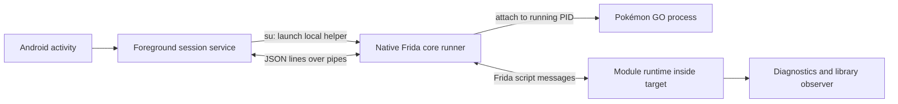

# PGQL 0.1 — Pokemon Go QoL

An original rooted Android arm64 injection app and module framework. This uses the official Frida core devkit and Java bridge; it does not depend on Pokemod's binaries, agents, backend, or credentials.

## What runs where



The phone runs the whole session. No desktop controller or frida-server is required. The app resolves the already-running `com.nianticlabs.pokemongo` PID through root, launches the packaged native helper through `su`, and loads your bundled agent. Standard Frida injects its own agent into the target; the runner then manages script/session lifecycle.

The app uses **resident-agent detach**: it requests module shutdown, waits for an acknowledgement, pins the now-inactive script, then detaches the controller. Tracked module resources are released and the menu is removed from the Activity, but Frida's engine, Java bridge internals and the inactive script remain in the game until that process exits. This avoids an observed native crash after full agent unloading on the connected phone. The native CLI supports both modes; `--resident-agent` selects this behavior. A missing shutdown acknowledgement is logged as an error and must not be treated as proof that resources were released. Reattaching loads a new script; repeatedly attaching can accumulate inactive script instances until the game process restarts. v0.1 has no resident-script reuse/hot-reload yet.

This first version is attach-only. Launch the game normally and wait for it to load before attaching. Spawn/resume support and a game-specific managed-code adapter can be added separately.

## Build on this Mac

Existing prerequisites: Python 3, a full JDK 21, Node.js/npm, and a POSIX shell. Build inputs stay under this project, not system installations.

```sh
cd /Users/jared/Development/pgql/framework
python3 scripts/bootstrap.py
npm ci
python3 scripts/build.py
```

The Java bundle pins `frida-java-bridge` 7.0.13 and esbuild 0.28.2 through `package-lock.json`. On Android 17, a checked-in compatibility patch from [upstream PR #400](https://github.com/frida/frida-java-bridge/pull/400) temporarily skips the JVMTI plugin’s heavy debug transition during plugin initialization, then restores the function and removes its temporary hooks. This is an unmerged upstream patch; it was tested on this phone, not across Android devices. The patch is applied to a build copy, leaving npm inputs intact. The bundle also defers the Java bridge’s eager constructor probe to its existing lazy initializer, and evaluates the pinned IL2CPP bridge only when a game module needs it. This keeps managed runtime probing out of script load.

Bootstrap pins Frida core **17.23.3**, Android NDK **27.2.12479018 (r27c)**, platform **35**, and build tools **35.0.0** from official release repositories. It verifies official checksum metadata and records SHA-256 values in `toolchains/dependencies.json`. Android tool downloads are macOS-specific. Set `JAVA_HOME` if your JDK lives elsewhere; the default points to this Mac's existing Homebrew JDK 21. Set `ANDROID_NDK_HOME` to use another existing compatible NDK. See the licenses shipped with the downloaded SDK/NDK inputs.

`build/pgql-debug.apk` is locally signed with the generated debug key in `build/debug.keystore`. Keep that key if you want future builds to update this installation. This is a development artifact. The project also contains Android Gradle configuration for Android Studio; prepare the agent/native runner with the scripts first. Gradle is an alternative workflow, not required by the tested manual build.

## Run on the phone

```sh
adb devices -l
adb install -r build/pgql-debug.apk
adb shell am start -n dev.qol.framework/.MainActivity
```

In PGQL, select **Launch game**, let it load, return to PGQL, then select **Attach**. Approve the phone's root-manager request for PGQL. Attach brings the game back to the foreground so Android's cached-process freezer does not block injection. Module commands also foreground it so the script can process them. Look for the `agent-ready` message and diagnostics showing the target PID/architecture. **Run diagnostics** asks the enabled module for a fresh snapshot. Enable **Library load observer** to observe subsequently loaded/unloaded native libraries. Disable it to detach its observer. **Detach** closes the input pipe and ends the instrumentation session; the notification provides the same action.

An attach failure appears in the log with its native stage and error. Native Frida compatibility with this phone/game build must be tested on the connected device. Root alone does not establish that a particular game version accepts attachment.

**Explicit policy option:** the unchecked **Apply Frida SELinux setup** box forwards `--prepare-selinux` to the runner. This invokes Frida's upstream `frida_selinux_patch_policy()` and changes the live system policy until reboot. Its rules permit instrumentation memory/files and communications across application domains; it is broader than this single target. The upstream helper may briefly change enforcement if a policy-load fallback is needed. Detaching does not revert those policy changes. Review the [pinned implementation](https://github.com/frida/frida-core/blob/17.23.3/lib/selinux/patch.c) before opting in. With the box off, the framework does not write SELinux policy. The connected phone produced an observed denial reading/writing `/memfd:frida-agent-64.so` before this option was added.

## Add your own module

Create `agent/modules/your-module.js`:

```js
Qol.register({
  id: 'example',
  name: 'Example',
  settings: [{key:'verbose',label:'Verbose logging',type:'boolean',default:false}],
  enable(ctx) {
    ctx.log('Enabled', { pid: Process.id, verbose: ctx.config.verbose });
    // ctx.hook(address, callbacks) tracks an Interceptor listener.
    // ctx.observeModules(callbacks) tracks a module observer.
    // ctx.interval(callback, milliseconds) tracks a timer.
    // ctx.cleanup(fn) tracks another synchronous cleanup action.
  },
  invoke(ctx, args) {
    ctx.log('Action requested', args);
    return { ok: true };
  },
  disable(ctx) {
    ctx.log('Disabled');
  }
});
```

Optional `actions: [{id:"preview",label:"Preview",confirm:false}]` declarations generate buttons in the injected panel. An action calls `invoke(ctx, {action: id})`; confirmed actions call `preview` first, show counts, then wait for Continue.

`enable` and `disable` are synchronous lifecycle callbacks in v0.1; `invoke` may return a Promise. The runtime owns each module's tracked hooks/timers/observers and releases them on disable, shutdown or a failed enable. IDs are unique. The app discovers module names/status from the agent's registry. Rebuild, reinstall and detach/reattach after editing modules. Hot reload is not implemented in v0.1. The injected **PGQL 0.1** button opens an Android settings panel in the game Activity. It displays the project name/version, module enable switches and every declared boolean setting. Configuration is stored in target-private `pgql_settings` preferences and restored on attachment. Use `ctx.config` to read current settings and `onConfigChanged(ctx, config)` for immediate updates. This panel is original Android UI; it does not yet use the Unity prefab menu that Pokemod uses.

Commands are JSON objects with `type: "command"`, an `id`, and an `action` (`list`, `enable`, `disable`, `invoke`, `config`). The `config` action carries `moduleId`, `key`, and boolean `value`. Module actions also carry `moduleId`; invoke may carry `args`. Agent responses echo the `id`, `ok`, and `result`/`error`. The helper wraps Frida messages in JSONL events on stdout. See `native/README.md` for standalone runner usage and limits.

## Extending into game modules

The recovered original app demonstrates a separate JavaScript managed-code bridge that resolves game services from the live Unity dependency-injection context. The core injector and that bridge are different layers. The foundation includes original diagnostics/observer modules tested inside the connected game, an injected settings panel, and an experimental Mass Gift module.

For friend gifting or other game UI modules, the next adapter should initialize against the managed runtime, resolve the needed service/type/method metadata, schedule Unity operations on the proper thread, and expose a small interface to modules. Keep compatibility maps outside individual modules. The connected phone's installed game version was confirmed as `0.431.0`, matching the recovered agent's map entry. Diagnostics confirmed the loaded Unity/IL2CPP/Niantic libraries. A first original game-gift adapter is now implemented, with a Unity-frame scheduler, version gate and Mass Gift queue. Its live validation status and limits are recorded in [MASS-GIFT.md](MASS-GIFT.md); native attachment instability remains unresolved. Do not copy the recovered agent's entire bootstrap merely to obtain its module API.

## Validation and boundaries

Build and protocol checks are recorded in `VALIDATION.md`. Local agent tests use an explicit mock of Frida globals and exercise only our original runtime, not the recovered Pokemod code. Native syntax/parser checks and an Android cross-build do not prove live injection. Device execution is reported separately.

Official API references: [Frida C API](https://frida.re/docs/c-api/), [Frida core API](https://frida.re/docs/frida-core-api/), [Frida JavaScript API](https://frida.re/docs/javascript-api/), and [pinned release](https://github.com/frida/frida/releases/tag/17.23.3).

### Feature catalog and Tamagotchi

The menu and controller now include all 32 requested feature slots. Planned
features are labeled and cannot be enabled. [FEATURES.md](FEATURES.md) maps their
scope and shared adapter boundaries. The module list scrolls independently of
the controller log so the complete catalog fits on screen.

Tamagotchi has an experimental care engine, persistent action/berry switches,
preview, pause/resume and status controls. Its 0.431.0 profile binds feeding,
play and souvenirs; automatic snapshots and battles remain unsupported. See
[TAMAGOTCHI.md](TAMAGOTCHI.md) for the adapter contract and device-probe limits.
`npm test` runs all eleven local suites, including the feature framework and buddy
lifecycle/timeout tests.

### Encounter toggles

**Instant Catch**, **Perfect Throw**, and **Headshot** are independent, default-off modules in the injected menu. Enable before entering an encounter and check **Feature status**. They target game 0.431.0; incompatible method contracts turn the module off. See [ENCOUNTERS.md](ENCOUNTERS.md) for behavior, cleanup, and the current runtime-validation limits.

### Virtual GO Plus

**Virtual GO Plus** emulates a genuine GO Plus accessory inside the game: the game pairs with a fabricated device and catches Pokemon / spins Pokestops natively (no throw animation), with automatic reconnect. Three boolean toggles (`auto-catch`, `auto-spin`, `auto-reconnect`, default on) apply live; a **Feature status** action reports connection state. See [GOPLUS.md](GOPLUS.md) for behavior and the version-pinned native contract. It is the first PGQL adapter that talks to `libholoholo.so` natively; the required struct offsets are pinned to GO 0.431.0 and documented there rather than left implicit.
